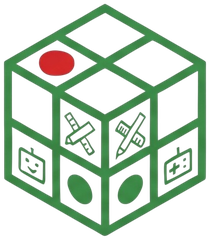
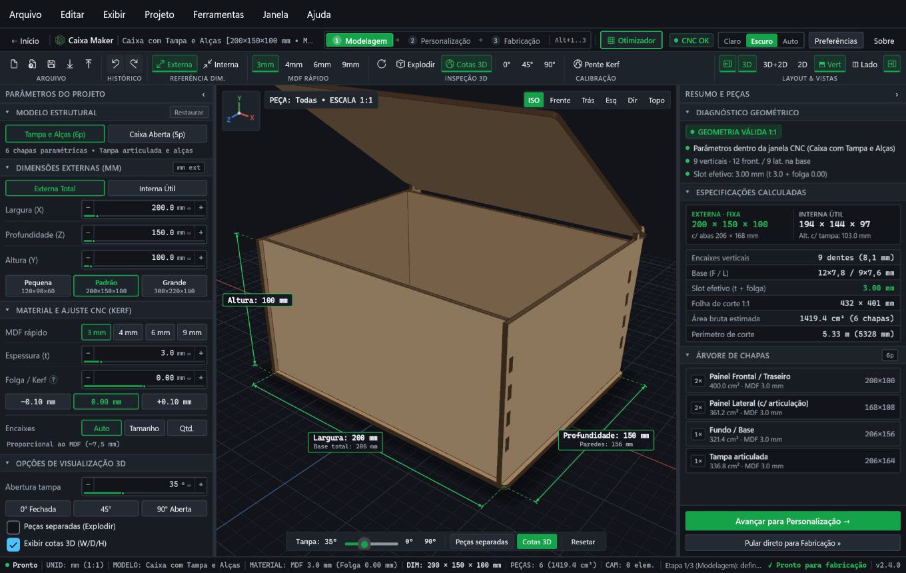
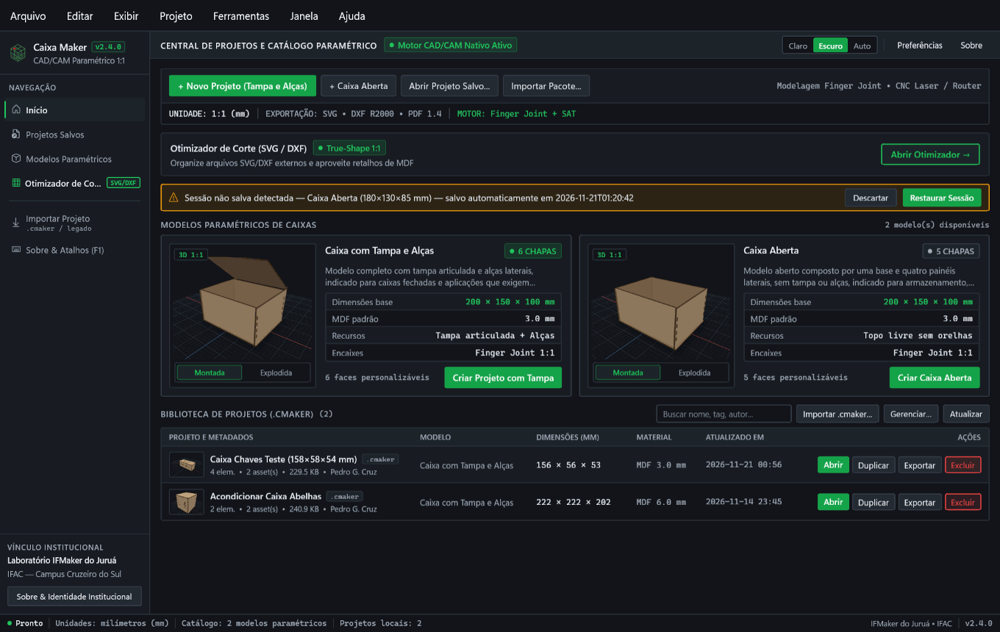
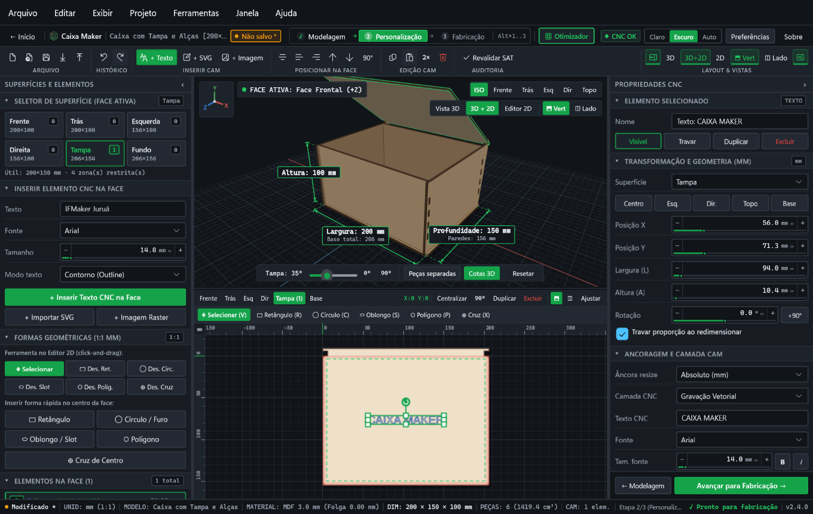
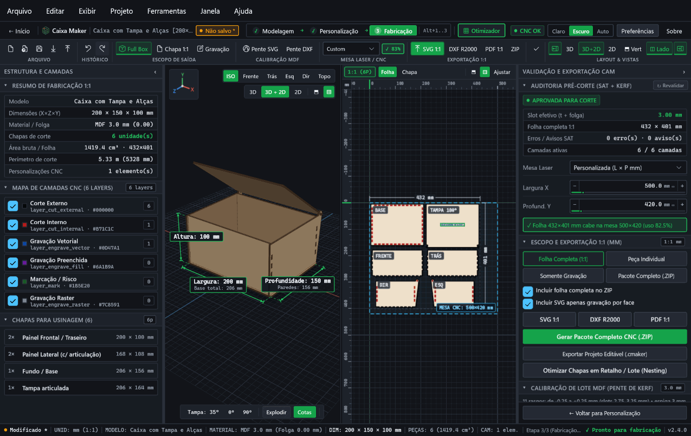
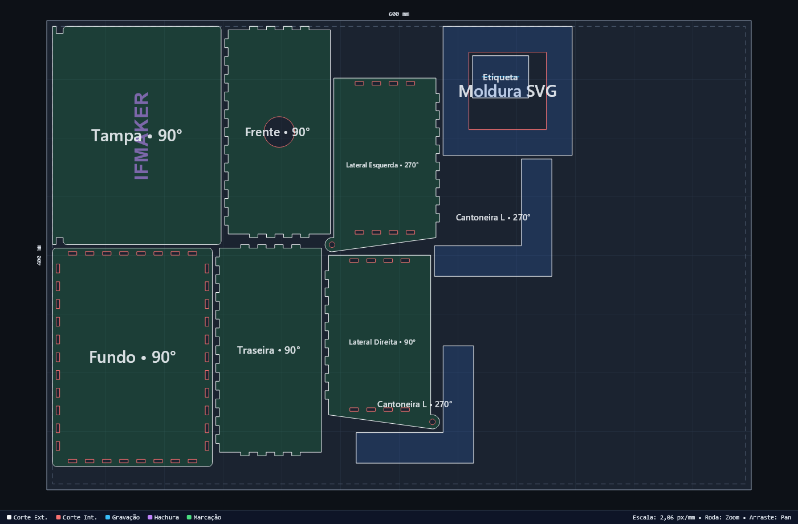

<div align="center">



# Caixa Maker

**Suíte CAD/CAM nativa para Windows voltada à modelagem paramétrica de caixas com encaixes *Finger Joint*, personalização CNC/Laser e otimização de corte 2D (*True-Shape Nesting*).**

[](https://github.com/PddroGCruz/caixa-maker/releases)
[](https://github.com/PddroGCruz/caixa-maker/releases)
[](#arquitetura-e-compilação-do-código-fonte)
[](#arquitetura-e-compilação-do-código-fonte)
[](LICENSE)

[Baixar Instalador (Releases)](https://github.com/PddroGCruz/caixa-maker/releases) •
[Guia para Iniciantes](#guia-rápido-para-iniciantes) •
[Funcionalidades](#funcionalidades-e-ferramentas) •
[Atalhos](#atalhos-de-teclado) •
[Compilar do Zero](#arquitetura-e-compilação-do-código-fonte)

</div>

<p align="center">
  
</p>

---

## Sumário

1. [Por que o Caixa Maker existe?](#por-que-o-caixa-maker-existe)
2. [Guia rápido para iniciantes](#guia-rápido-para-iniciantes)
3. [Funcionalidades e ferramentas](#funcionalidades-e-ferramentas)
4. [Atalhos de teclado](#atalhos-de-teclado)
5. [Instalação (Windows x64)](#instalação-windows-x64)
6. [Arquitetura e compilação do código-fonte](#arquitetura-e-compilação-do-código-fonte)
7. [Vínculo institucional, autoria e licença](#vínculo-institucional-autoria-e-licença)

---

## Por que o Caixa Maker existe?

Quem opera cortadoras a laser ou routers CNC em laboratórios maker, escolas técnicas e oficinas sabe onde o tempo costuma ir embora: recalcular *kerf* na mão a cada lote de MDF, redesenhar encaixes que deformam quando a caixa muda de tamanho, separar manualmente cores de corte e gravação no LightBurn ou RDWorks e perder chapas inteiras porque as peças não cabem nos retalhos sobrando na bancada.

O **Caixa Maker** reúne esse fluxo inteiro em um aplicativo desktop nativo para Windows, 100% offline e em **escala real `1:1` (milímetros)**. Você define as medidas, personaliza cada face com validação automática de colisão, calibra o aperto do MDF com um pente de *kerf*, organiza as peças em retalhos via *True-Shape Nesting* e exporta arquivos vetoriais prontos para corte em **SVG**, **DXF R2000** ou **PDF 1.4**.

---

## Guia rápido para iniciantes

O programa segue um fluxo guiado em **3 etapas (`1 Modelagem → 2 Personalização → 3 Fabricação`)**, além do **Otimizador de Corte 2D** acessível a qualquer momento.

### Passo 0 — Central de Projetos (Catálogo)

Ao abrir o Caixa Maker, você escolhe entre iniciar uma caixa paramétrica (**Caixa com Tampa e Alças** com 6 chapas ou **Caixa Aberta** com 5 chapas), reabrir projetos `.cmaker` da biblioteca local ou entrar direto no **Otimizador de Corte (SVG / DXF)** para organizar arquivos externos em retalhos de MDF.

<p align="center">
  
</p>

---

### Passo 1 — Modelagem 3D

Na Etapa 1, você define a estrutura da caixa com retorno imediato no viewport 3D:

1. **Referência dimensional:** alterne entre **Externa Total** (tamanho final por fora) e **Interna Útil** (vão livre interno — ideal quando você precisa acomodar uma placa, componente ou objeto de medida exata; ao trocar a espessura do MDF, as medidas externas se ajustam sozinhas).
2. **Dimensões (`L × P × A`):** digite os valores em milímetros, use os presets rápidos (*Pequena*, *Padrão*, *Grande*) ou clique diretamente nas cotas 3D sobre o modelo. Os campos numéricos aceitam expressões matemáticas como `150 + 2*3` ou `240 / 2`.
3. **Material e Folga (`Kerf`):** selecione a espessura real do MDF (`3`, `4`, `6`, `9 mm` ou valor manual) e a compensação bilateral de *kerf* (`-0,10`, `0,00`, `+0,10 mm` ou medida calibrada). Valores negativos deixam o encaixe mais justo; positivos alargam os rasgos.
4. **Encaixes (*Finger Joint*):** escolha entre **`Auto`** (padrão recomendado), **`Tamanho`** (largura-alvo em mm) ou **`Qtd.`** (número fixo de espigas por aresta).
5. **Diagnóstico em tempo real:** o painel direito exibe as medidas externas e internas, a contagem e largura dos dentes (`Encaixes verticais` e `Base (F / L)`), a área estimada de material e a árvore clicável das chapas.

> [!NOTE]
> Você pode arrastar o modelo 3D para orbitar, abrir a tampa de `0°` a `110°` ou marcar **Peças separadas (Explodir)** para inspecionar o encaixe entre todas as chapas antes de avançar.

---

### Passo 2 — Personalização CNC

Clique em **Avançar para Personalização →** (ou pressione `Alt+2`) para abrir o Editor 2D e o Viewport 3D lado a lado:

<p align="center">
  
</p>

1. **Escolha a face ativa:** selecione *Frente*, *Trás*, *Esquerda*, *Direita*, *Tampa* ou *Fundo*. As faixas tracejadas em vermelho marcam as **zonas restritas de encaixe (*Finger Joint*, rasgos passantes e orelhas de dobradiça)**.
2. **Adicione elementos `1:1`:**
   - **Texto vetorizado:** usa fontes TrueType/OpenType do Windows em modo *Contorno*, *Preenchimento Sólido* ou *Hachura 45°*.
   - **Formas geométricas paramétricas:** desenhe diretamente na chapa (*click-and-drag*) com `R` (Retângulo), `C` (Círculo/Furo), `S` (Oblongo/Slot), `P` (Polígono regular) ou `X` (Cruz de centro), com *snap* magnético e guias de alinhamento.
   - **SVG e Imagens Raster:** importe logomarcas `.svg` ou imagens PNG/JPG/BMP (para gravação raster ou vetorização de contornos).
3. **Alinhe e valide:** use seleção múltipla (`Shift + Clique`, caixa *marquee* ou `Ctrl+A`), o painel **Alinhar & Distribuir** (estilo Inkscape), **Espelhamento nos 4 Cantos** e **Grade Linear**. A auditoria geométrica **SAT** alerta automaticamente se algum elemento invadir os encaixes ou sobrepor outro recorte.

---

### Passo 3 — Fabricação e Exportação `1:1`

Avance para **Fabricação** (`Alt+3`) para conferir a prancha completa na escala real antes de ir para a máquina:

<p align="center">
  
</p>

1. **Mesa Laser / CNC:** selecione o tamanho útil da área de corte da sua máquina (ou informe medidas manuais) para verificar imediatamente se a folha cabe na mesa e qual a taxa de ocupação.
2. **Conferência de camadas:** revise o mapa das 6 layers semânticas e a auditoria pré-corte SAT.
3. **Exportação pronta para a máquina:** salve a folha completa, uma chapa individual ou apenas as camadas de gravação em **SVG**, **DXF R2000** ou **PDF 1.4**, ou gere o **Pacote Completo CNC (.ZIP)** contendo todos os formatos e uma cópia editável `.cmaker`.

> [!TIP]
> **Primeira vez cortando um lote novo de MDF?** Antes de cortar a caixa inteira, use o **Pente de Calibração de Kerf** na barra superior da Etapa 3. Corte essa pequena peça de teste, faça o *dry-fit* encaixando a espiga lateral nos rasgos numerados (`-0.25` até `+0.25 mm`) e aplique o valor que der o aperto ideal no campo **Folga / Kerf** da Etapa 1.

---

### Otimizador de Corte 2D (*True-Shape Nesting*)

O Otimizador de Corte 2D é uma ferramenta de primeiro nível do Caixa Maker e funciona de duas maneiras:

- **Modo independente (para qualquer arquivo `.svg` ou `.dxf`):** acesse pelo botão **Otimizador de Corte** na barra lateral do Catálogo, pelos menus **Arquivo / Projeto / Ferramentas**, pelo botão **Otimizador** no cabeçalho ou pelo atalho global **`Alt+4`**. Importe arquivos SVG/DXF externos, informe o tamanho do retalho de MDF disponível e otimize o corte sem precisar criar uma caixa.
- **Modo integrado (lote de caixas + retalhos):** na Etapa 3 (**Fabricação**), clique em **Otimizar Chapas em Retalho / Lote (Nesting)**. Todas as 5 ou 6 chapas da caixa ativa (com encaixes e personalizações) entram direto da memória, permitindo multiplicar o lote (ex.: cortar 3 ou 5 caixas de uma vez) e misturar peças externas SVG/DXF na mesma chapa.

<p align="center">
  
</p>

> [!NOTE]
> No exemplo acima (chapa MDF `600 × 400 mm`), o motor *True-Shape* encaixou as 6 chapas da caixa junto com duas cantoneiras em `L` aproveitando as concavidades ao redor das dobradiças e posicionou uma etiqueta SVG dentro do recorte interno da moldura — preservando furos internos (`fill-rule="evenodd"`) nas gravações preenchidas.

---

## Funcionalidades e ferramentas

### Modelos paramétricos e encaixes adaptativos (*Finger Joints*)

| Modelo | Chapas | Características estruturais |
| :--- | :---: | :--- |
| **Caixa com Tampa e Alças** | 6 | Base com rasgos passantes, 4 paredes, orelhas laterais com furos calibrados e tampa articulada com pinos pivotantes. |
| **Caixa Aberta** | 5 | Base com rasgos passantes e 4 paredes com borda superior reta, ideal para organizadores e bandejas. |

Os encaixes *Finger Joint* são calculados de forma unificada nas arestas verticais e na base em 3 modos selecionáveis:

- **`Auto` (padrão):** calcula a largura-alvo proporcional à espessura da chapa por `clamp(2,2 × t, 7,5, 16,0)` — resultando em ~`7,5 mm` (MDF 3 mm), ~`8,8 mm` (4 mm), ~`13,2 mm` (6 mm) e ~`16,0 mm` (9 mm). Em caixas pequenas, aplica um piso preferencial de **5 segmentos (2 espigas)** nas quinas verticais sempre que o dente atingir `>= max(4,0 mm; t)`, evitando efeito pivô e reservando 3 segmentos (1 espiga) apenas para caixas muito rasas.
- **`Tamanho` (`TargetSizeMm`):** você informa a largura desejada do dente entre `3,0` e `40,0 mm` (passo `0,5 mm`), e cada aresta calcula automaticamente o número ímpar de segmentos mais próximo desse alvo.
- **`Qtd.` (`FixedCount`):** trava a quantidade-base de espigas por aresta (`2` a `25`), com redução automática de segurança caso alguma aresta seja curta demais para manter o mínimo estrutural (`>= 3,0 mm`).

### Sistema de 6 layers semânticas CAM

Todos os arquivos exportados (**SVG**, **DXF R2000 / `AC1015`** e **PDF 1.4**) — tanto da Etapa 3 quanto do Otimizador de Corte — seguem o mesmo padrão de camadas para reconhecimento imediato no LightBurn, RDWorks, LaserGRBL, Inkscape e CorelDRAW:

| Layer DXF | ID SVG (`<g id="...">`) | Cor HEX | Espessura / Regra | Finalidade na máquina |
| :--- | :--- | :---: | :--- | :--- |
| `CUT_EXTERNAL` | `layer_cut_external` | `#000000` | `0,03 mm` (traço) | Contorno externo das chapas e dentes *Finger Joint* (cortar por último). |
| `CUT_INTERNAL` | `layer_cut_internal` | `#B71C1C` | `0,03 mm` (traço) | Rasgos passantes, furos da dobradiça e recortes vazados internos. |
| `ENGRAVE_VECTOR` | `layer_engrave_vector` | `#0D47A1` | `0,10 mm` (traço) | Gravação de linha vetorial (contornos de texto, formas e hachuras `45°`). |
| `ENGRAVE_FILL` | `layer_engrave_fill` | `#6A1B9A` | `fill-rule="evenodd"` | Gravação preenchida de superfície preservando furos de letras e logomarcas compostas. |
| `MARK` | `layer_mark` | `#1B5E20` | `0,10 mm` (traço) | Marcação leve superficial e cruzes de centro/referência. |
| `ENGRAVE_RASTER` | `layer_engrave_raster` | *(PNG)* | Bitmap `1:1` embarcado | Imagens raster preparadas para gravação por varredura a laser. |

*(No Otimizador de Corte, a camada auxiliar opcional `SHEET_BOUNDS` / `layer_sheet_bounds` em `#94A3B8` serve apenas como referência visual do retalho.)*

### Otimizador de Corte 2D (*True-Shape Nesting*)

- **Algoritmo *True-Shape* multi-estratégia:** avalia ordenações determinísticas por área, maior dimensão e *bounding box*, aproveitando concavidades reais e, opcionalmente, encaixando peças menores dentro de furos internos grandes (`AllowNestingInHoles`).
- **Importador DXF ASCII `1:1`:** leitura de `$INSUNITS` (conversão automática de polegadas, centímetros, metros e milímetros), suporte a `LINE`, `LWPOLYLINE` (incluindo arcos via *bulge*), `POLYLINE`/`VERTEX`/`SEQEND`, `CIRCLE`, `ARC`, `ELLIPSE` e `SPLINE` (avaliação De Boor), costura automática de contornos abertos (`<= 0,05 mm`) e agrupamento hierárquico Ponto-em-Polígono.
- **Importador SVG `1:1`:** sanitização segura, conversão de unidades (`mm`, `cm`, `in`, `pt`, `px` a 96 DPI), classificação automática de layers CAM e preservação de caminhos compostos (`evenodd` em SVG, operador `f*` em PDF e `SKPathFillType.EvenOdd` no preview SkiaSharp).
- **Controle de produção:** políticas de rotação por peça (`0°` travado para respeito ao veio da madeira, `180°`, `90°`, `45°`), margem de borda do retalho, espaçamento entre cortes, distribuição automática multi-chapa e exportação individual ou em `.ZIP` com relatório técnico de aproveitamento (`%`).

### Projetos autocontidos (`.cmaker`) e calibração de MDF

- **Formato `.cmaker`:** arquivo ZIP estruturado contendo manifesto com verificação de integridade **SHA-256** por arquivo, parâmetros construtivos (incluindo modo de encaixes e *kerf*), personalizações por chapa, ativos SVG/raster originais deduplicados em `assets/` e miniaturas 3D/2D. Registra associação nativa no Windows Explorer para abertura com duplo clique.
- **Histórico e recuperação:** pilha de Undo/Redo (até 40 passos na personalização), salvamento automático de rascunho de sessão e migração retrocompatível de projetos antigos.
- **Pente de Calibração de Kerf:** gerador paramétrico de `7` a `21` rasgos calibrados com passo configurável (ex.: `0,05 mm`), marcações numéricas gravadas e espiga de referência para teste *dry-fit*, exportável em SVG, DXF e PDF `1:1`.

---

## Atalhos de teclado

<details open>
<summary><strong>Navegação, Projeto, Edição e Ferramentas CAD 2D</strong> (clique para recolher/expandir)</summary>

| Categoria | Atalho | Ação | Contexto |
| :--- | :--- | :--- | :--- |
| **Navegação** | `Alt + 1` | Ir para Etapa 1 — Modelagem | Projeto aberto |
| **Navegação** | `Alt + 2` | Ir para Etapa 2 — Personalização | Projeto aberto |
| **Navegação** | `Alt + 3` | Ir para Etapa 3 — Fabricação | Projeto aberto |
| **Navegação** | `Alt + 4` | Abrir Otimizador de Corte 2D (SVG / DXF / Nesting) | Global |
| **Visualização** | `Ctrl + 1 / 2 / 3` | Alternar Viewport 3D / Editor 2D / Dividido (3D + 2D) | Projeto aberto |
| **Visualização** | `Ctrl + B` / `Ctrl + Shift + B` | Mostrar/ocultar painel esquerdo / painel direito | Projeto aberto |
| **Visualização** | `Ctrl + R` | Restaurar câmera 3D padrão | Projeto aberto |
| **Visualização** | `Alt + E` | Alternar vista explodida 3D | Projeto aberto |
| **Visualização** | `Alt + D` | Abrir / fechar tampa articulada | Modelo com Tampa |
| **Visualização** | `Ctrl + Shift + V` | Alternar visibilidade das cotas 3D | Projeto aberto |
| **Visualização** | `F11` | Alternar tela cheia | Global |
| **Arquivo** | `Ctrl + N` | Novo projeto no modelo atual | Projeto aberto |
| **Arquivo** | `Ctrl + O` | Abrir gerenciador de projetos salvos | Global |
| **Arquivo** | `Ctrl + Shift + O` | Importar pacote de projeto (`.cmaker` / `.caixamaker.json`) | Global |
| **Arquivo** | `Ctrl + S` / `Ctrl + Shift + S` | Salvar projeto / Salvar como... (`.cmaker`) | Projeto aberto |
| **Arquivo** | `Ctrl + E` | Exportar projeto autocontido (`.cmaker`) | Projeto aberto |
| **Edição** | `Ctrl + Z` / `Ctrl + Y` | Desfazer / Refazer alteração de personalização | Personalização |
| **Edição** | `Ctrl + C` / `Ctrl + V` / `Ctrl + D` | Copiar / Colar / Duplicar elemento selecionado | Personalização |
| **Edição** | `Ctrl + A` | Selecionar todos os elementos da face ativa | Personalização |
| **Edição** | `Delete` | Excluir elemento(s) selecionado(s) | Personalização |
| **Edição** | `Ctrl + Shift + Backspace` | Limpar todos os elementos da face | Personalização |
| **Ferramentas 2D** | `V` | Selecionar / Mover | Editor 2D |
| **Ferramentas 2D** | `R` / `C` / `S` / `P` / `X` | Desenhar Retângulo / Círculo / Oblongo / Polígono / Cruz | Editor 2D |
| **Ferramentas 2D** | `Esc` | Cancelar desenho ativo e voltar para Seleção | Editor 2D |
| **Auditoria e Ajuda** | `F5` | Executar validação geométrica SAT | Projeto aberto |
| **Auditoria e Ajuda** | `Ctrl + ,` | Abrir Preferências e Configurações | Global |
| **Auditoria e Ajuda** | `F1` | Abrir Sobre e Referência de Atalhos | Global |

</details>

---

## Instalação (Windows x64)

O Caixa Maker é distribuído como aplicativo **autocontido (`win-x64`)**: roda 100% offline e já embarca todas as bibliotecas necessárias, sem exigir instalação prévia de runtimes externos.

- **Requisitos mínimos:** Windows 10 (build 19041+) ou Windows 11, arquitetura **64-bit (x64)**.

### Como instalar

1. Acesse a página de **[Releases](https://github.com/PddroGCruz/caixa-maker/releases)** e baixe o instalador da versão **`v2.4.0`**:
   - **`CaixaMaker-Setup-2.4.0-x64.exe`** *(recomendado para uso individual)* — instalador NSIS em português (`pt-BR`) com instalação rápida por usuário e associação automática da extensão `.cmaker`.
   - **`CaixaMaker-2.4.0-x64.msi`** *(recomendado para laboratórios e escolas)* — pacote Windows Installer (WiX) voltado a instalação padronizada e implantação corporativa.
2. Execute o instalador escolhido e abra o **Caixa Maker** pelo Menu Iniciar ou atalho da Área de Trabalho.

---

## Arquitetura e compilação do código-fonte

A solution `native-winui/CaixaMaker.sln` segue *Clean Architecture* + *MVVM* com separação estrita entre matemática geométrica, processamento CAM, camada de apresentação/renderização SkiaSharp (com caches estáticos 2D/3D) e interface nativa WinUI 3:

```text
native-winui/
├── CaixaMaker.sln
├── Directory.Build.props
├── installer/
│   ├── nsis/                  # Instalador NSIS x64 em pt-BR
│   └── wix/                   # Pacote MSI (WiX Toolset v3.14 pt-BR)
├── src/
│   ├── CaixaMaker.Core/       # Geometria 1:1, encaixes adaptativos, modelos, SAT, Nesting e storage
│   ├── CaixaMaker.Cam/        # Vetorização de texto/SVG/raster, DXF/SVG 1:1, pente de kerf e exportadores
│   ├── CaixaMaker.Presentation/ # ViewModels MVVM, Z-Buffer 3D/2D SkiaSharp, Nesting renderer e .cmaker
│   └── CaixaMaker.App/        # Interface WinUI 3, Splash Screen, Otimizador 2D e controles CAD
└── tests/
    └── CaixaMaker.Tests/      # Suíte automatizada com 360 testes xUnit
```

### Pré-requisitos de desenvolvimento

- **Windows 10 / 11 (x64)**
- **SDK `.NET 8.0`** com suporte a aplicativos Desktop Windows / Windows App SDK
- *(Opcional, apenas para gerar instaladores)* **NSIS** (`makensis.exe`) e **WiX Toolset v3.14**

### Comandos de build, testes e empacotamento (PowerShell)

```powershell
# 1. Clonar o repositório
git clone https://github.com/PddroGCruz/caixa-maker.git
cd caixa-maker

# 2. Compilar a solution em Release x64
dotnet build native-winui/CaixaMaker.sln -c Release -p:Platform=x64

# 3. Executar todos os 360 testes automatizados (xUnit)
dotnet test native-winui/CaixaMaker.sln -c Release -p:Platform=x64 --no-build -- xUnit.ParallelizeTestCollections=false

# 4. Executar o smoke test headless da interface WinUI 3 (exit code 0)
native-winui\src\CaixaMaker.App\bin\x64\Release\net8.0-windows10.0.19041.0\CaixaMaker.exe --smoke-test

# 5. (Opcional) Gerar publicação autocontida + instaladores NSIS (.exe) e WiX (.msi) em release/
powershell -ExecutionPolicy Bypass -File scripts\build_native_release.ps1
```

> [!NOTE]
> Se o SDK `.NET 8.0` estiver instalado no diretório local do usuário (sem estar no `PATH` global), substitua `dotnet` por `& "$env:LOCALAPPDATA\Microsoft\dotnet\dotnet.exe"`.

---

## Vínculo institucional, autoria e licença

- **Instituição:** Laboratório **IFMaker do Juruá** — Instituto Federal do Acre (**IFAC**), Campus Cruzeiro do Sul *(Programa PIBIT)*.
- **Autor e desenvolvedor:** **Pedro G. Cruz (`PddroGCruz`)** — `ggcostcr@gmail.com` • [github.com/PddroGCruz](https://github.com/PddroGCruz).
- **Licença:** Projeto *open source* distribuído sob a **Licença MIT**. Consulte o arquivo [LICENSE](LICENSE) para detalhes.
